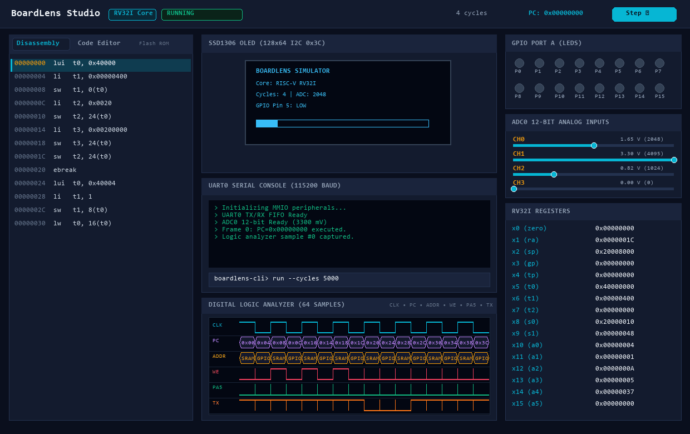
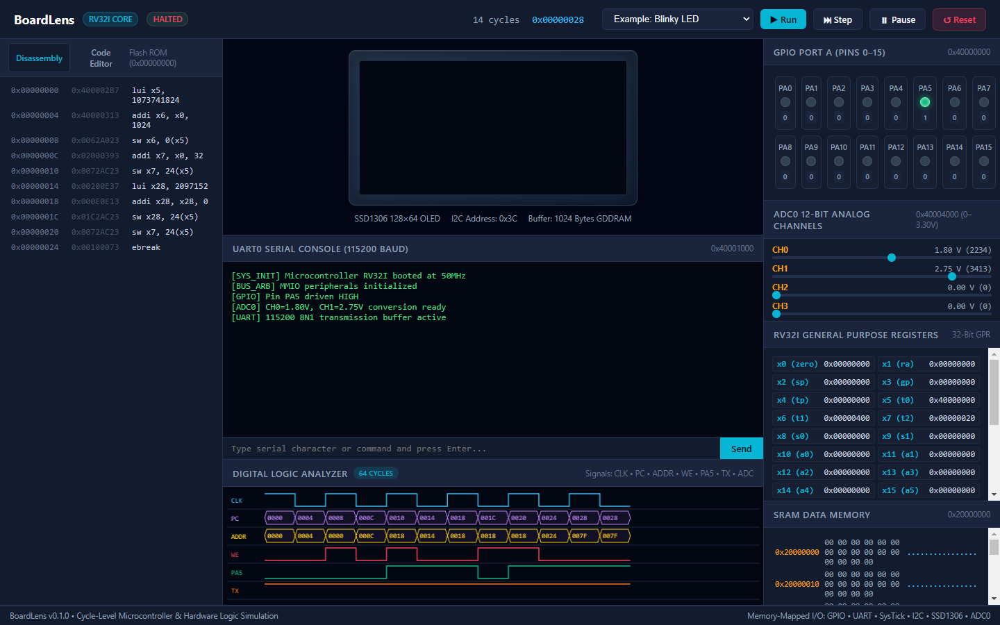
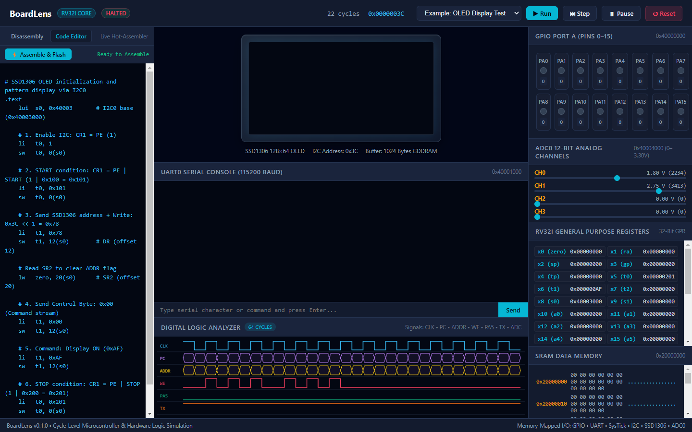
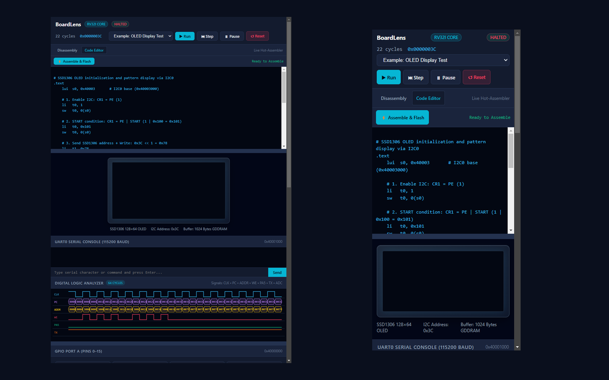
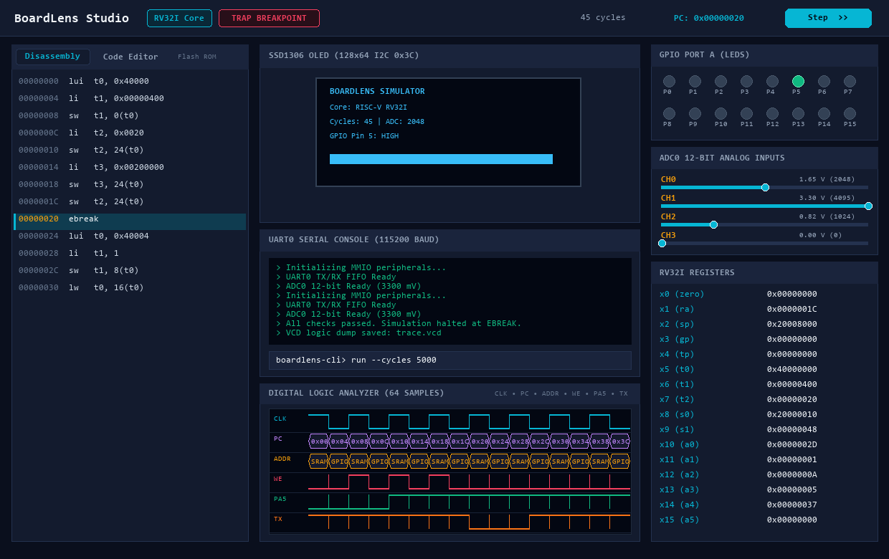
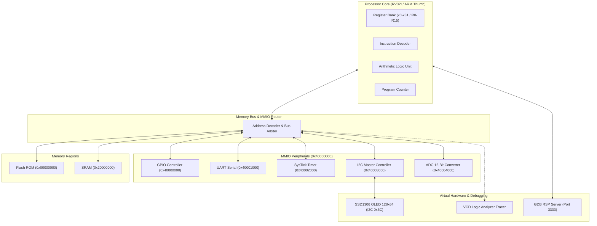

<p align="center">
  
</p>

<h1 align="center">BoardLens</h1>

<p align="center">
  Virtual microcontroller and hardware logic simulator for embedded systems engineers.
</p>

<p align="center">
  <a href="LICENSE"></a>
  <a href="https://www.python.org/downloads/"></a>
  <a href="#testing"></a>
</p>

<p align="center">
  
</p>

| Real-Time Execution | Code Editor & Hot-Assembler |
|:---:|:---:|
|  |  |
| **Responsive Multi-Device Layout** | **Logic Analyzer & Telemetry** |
|  |  |

BoardLens simulates 32-bit microcontrollers at the instruction cycle and bus transaction level. It combines a RISC-V RV32I execution engine with memory-mapped peripherals, authentic serial communication protocols, an SSD1306 OLED display emulator, a Value Change Dump (VCD) waveform generator, an integrated assembler/disassembler, a Typer command-line interface, and an interactive FastAPI Web Studio.


---

## Key Features

- **RISC-V RV32I Core**: Full 37-instruction base integer ISA decoding and execution with sign extensions, branch offsets, and CSR foundations.
- **ARM Cortex-M Foundation**: Thumb-1 16-bit instruction set decoder and register bank for dual-architecture experiments.
- **Memory-Mapped Bus (MMIO)**: Configurable memory map with Flash ROM, SRAM, and peripheral address windows. Catches unaligned accesses and unmapped bus faults.
- **Hardware Peripherals**:
  - **GPIO Controller**: Port pin direction registers (MODER), output data (ODR), input data (IDR), and bit set/reset (BSRR).
  - **UART Transceiver**: TX/RX FIFO queues, baud rate divisor calculation, status registers (TXE, RXNE), and stream capture.
  - **Hardware Timer / SysTick**: Periodic counter, auto-reload, and tick event generation.
  - **I2C Bus Controller**: Multi-state transaction engine supporting START, 7-bit addressing, ACK/NACK handshake, data payload transfer, and STOP condition handling.
- **SSD1306 OLED Virtual Device**: 128x64 monochrome display attached via I2C address 0x3C. Emulates GDDRAM page/column addressing, contrast control, display inversion, and bitmap rendering.
- **2D Graphics & ASCII Font Engine**: Built-in primitives library for drawing lines, rectangles, rounded boxes, circles, triangles, text strings with word wrapping, and 1-bit monochrome bitmaps.
- **12-Bit ADC Peripheral**: Multi-channel successive approximation analog converter mapped at `0x40004000` supporting 0 to 3300 mV inputs with single and continuous conversion modes.
- **ELF32 Executable Loader**: Parses standard ELF32 headers, program headers (`PT_LOAD`), sections, and symbol tables (`.symtab` / `.strtab`) for direct execution of GCC/Clang compiled binaries.
- **GDB Remote Serial Protocol (RSP) Server**: Embedded GDB stub server listening on TCP port 3333 for remote debugging with `gdb-multiarch` (breakpoints, memory inspection, registers, step, continue).
- **Logic Analyzer & VCD Trace Export**: Generates IEEE 1364-1995 standard Value Change Dump files for waveform inspection in PulseView or GTKWave.
- **Integrated RV32I Assembler & Disassembler**: Assembles assembly source code with label resolution and pseudo-instructions (`li`, `la`, `mv`, `nop`, `j`, `ret`).
- **Web Studio & Live Telemetry**: FastAPI backend with WebSocket streaming, interactive register inspection, RAM viewer, GPIO LED/button toggles, serial console, analog voltage sliders, live code editor, and canvas digital logic analyzer.

---

## System Architecture



---

## Memory Map

BoardLens organizes address space into 32-bit aligned regions:

| Base Address | Size | Region Name | Access | Description |
|:---|:---|:---|:---:|:---|
| `0x00000000` | 128 KB | Flash ROM | R/X | Firmware execution image |
| `0x20000000` | 64 KB | SRAM | R/W | Stack, heap, and static variables |
| `0x40000000` | 1 KB | GPIO Port A | R/W | Pin direction, data input/output |
| `0x40001000` | 1 KB | UART0 | R/W | Serial transmission and reception |
| `0x40002000` | 1 KB | SysTick Timer | R/W | Periodic tick counter and reload |
| `0x40003000` | 1 KB | I2C0 Controller | R/W | Bus control, status, and data registers |
| `0x40004000` | 1 KB | ADC0 Converter | R/W | 12-bit analog input channels (0-3.30V) |


---

## Installation

```bash
git clone https://github.com/alexandrmotologa/boardlens.git
cd boardlens
pip install -e ".[dev]"
```

Verify the installation:

```bash
boardlens --help
```

---

## Command Line Interface

### Run Firmware

Execute compiled machine code or assembly directly:

```bash
# Run a binary with cycle limit and live UART output
boardlens run examples/blinky.bin --cycles 50000

# Run assembly directly with VCD waveform tracing
boardlens run examples/oled_demo.s --trace trace.vcd --cycles 100000
```

### Assemble Code

Assemble human-readable RV32I source code into raw binary:

```bash
boardlens asm examples/fibonacci.s -o firmware.bin
```

### Disassemble Binary

Inspect binary instructions with memory offsets:

```bash
boardlens disasm firmware.bin
```

### Launch Web Studio

Start the local web environment for visual debugging:

```bash
boardlens studio --port 8000 --reload
```

Then open `http://localhost:8000` in any web browser.

### Run GDB Debug Stub Server

Launch the GDB Remote Serial Protocol (RSP) server for source-level debugging:

```bash
boardlens gdb-server --port 3333 --bin examples/blinky.bin --core rv32i
```

Connect using standard GNU Debugger:

```bash
gdb-multiarch -ex "target remote 127.0.0.1:3333"
```


---

## Web Studio

The Web Studio provides a real-time instrumentation panel:

1. **CPU Registers**: Inspect all 32 integer registers with standard ABI names and decimal/hexadecimal view.
2. **Instruction Disassembly**: Step-by-step program execution with current PC highlight and breakpoint control.
3. **GPIO Breadboard**: Visual LED indicators for output pins and interactive toggle switches for input pins.
4. **Interactive UART Console**: Send characters and read streaming firmware output.
5. **SSD1306 128x64 OLED Screen**: Real-time canvas updating directly from display GDDRAM updates over the simulated I2C bus.
6. **Waveform Logic Analyzer**: Live timeline traces for clock, bus cycles, and pin state changes.

---

## Python API Usage

```python
from boardlens.board import Board
from boardlens.tooling.assembler import assemble

# Write short RV32I assembly program
source = """
    .text
    addi t0, zero, 42
    addi t1, zero, 58
    add  a0, t0, t1
    ebreak
"""

binary = assemble(source)

# Create and boot board
board = Board(core="rv32i")
board.load_flash(binary)

# Step execution until ebreak
board.run(max_cycles=100)

print(f"Result in a0 (x10): {board.cpu.registers.read(10)}")  # 100
print(f"Total cycles: {board.cycles}")
```

---

## Testing

Run the full automated test suite:

```bash
pytest -v
```

---

## License

MIT License. See [LICENSE](LICENSE) for details.
